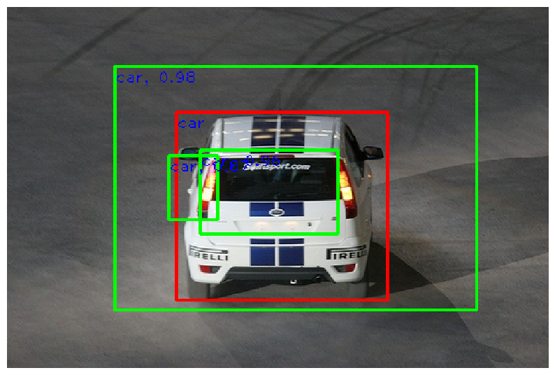

# Single-Stage Object Detection with PyTorch

A university lab for **Deep Learning for Image Signal Processing** at
**Universidad Autónoma de Madrid**. The project builds a YOLO-style detector on
PASCAL VOC 2007 and studies how classification loss affects detection quality.

The implementation covers anchor generation, box transformations, intersection
over union, objectness prediction, bounding-box regression, non-maximum
suppression, and cross-entropy versus focal-loss experiments.



*An example from the original notebook outputs. The repeated, misaligned boxes
illustrate the lab's localization and objectness limitations.*

## Model and experiments

The detector uses an ImageNet-pretrained **MobileNetV2** backbone with 224 × 224
inputs. A 7 × 7 feature grid, nine anchor shapes per cell, and a small convolutional
head produce objectness scores, four box offsets per anchor, and logits for the
20 VOC classes. Class logits are shared by anchors in the same cell.

The training runs use 2,500 images from the VOC 2007 `train` split, batch size 100,
SGD with learning rate 0.05, and 50 epochs. Evaluation uses the `val` split and the
external Cartucho/mAP tool at its default IoU threshold of 0.5.

| Experiment in the submitted report | Reported mAP |
| --- | ---: |
| Regular YOLO loss, with positive sample filtering | 12.30% |
| Regular YOLO loss, without positive sample filtering | 11.33% |
| Focal loss, without positive sample filtering | 11.51% |

These are historical report results, not measurements from the repository cleanup.
Saved notebook runs contain different values, and the “without filtering” code
actually changes classification-loss reduction after positives have already been
selected. See [results and interpretation](docs/RESULTS.md) for the evidence and
the distinction between these experiments.

## Getting started

Use Python 3.10 or newer; Python 3.12 is the version configured for CI. From the
repository root:

```bash
python3 -m venv .venv
source .venv/bin/activate
python -m pip install --upgrade pip
python -m pip install -r requirements.txt
python -m ipykernel install --user --name uam-object-detection --display-name "UAM Object Detection"
jupyter lab
```

On Windows, activate the environment with `.venv\Scripts\activate`. Select the
**UAM Object Detection** kernel in Jupyter. A CUDA GPU is recommended for full
training; CPU is supported for inspecting the model and running sanity checks.

Start with [01_single_stage_detection.ipynb](notebooks/01_single_stage_detection.ipynb)
for the detector walkthrough. It retains the first notebook's per-image focal-loss
configuration. Use [02_loss_experiments.ipynb](notebooks/02_loss_experiments.ipynb)
for the cross-entropy baseline and the later loss experiments. Run each notebook
from a fresh kernel and execute cells in order; later experiments redefine the
classification loss. The reusable Python module defaults to cross entropy.

The first dataset cell downloads VOC 2007 into `data/` if it is not already
extracted. Backbone weights also download on first use. Reserve about 1 GB for the
dataset and archive; see [dataset setup](data/README.md) for an existing download.
Reduce `num_epochs` and the training subset for a quick trial. The mAP evaluation
cell clones its optional dependency into `external/mAP/` and runs without plots.

For Google Colab, select a GPU runtime, clone your repository into the runtime,
install it with `%pip install -e '/content/your-checkout[notebooks]'`, and change
the working directory to that checkout before running the setup cells. You can
also keep a checkout in Drive and use the notebook's optional Drive mount. Set
`OBJECT_DETECTION_ROOT` if automatic path discovery cannot find the checkout.

## Repository layout

```text
├── notebooks/               Completed lab walkthroughs and loss experiments
├── src/
│   ├── single_stage_detector.py  Reusable detector and geometry/loss functions
│   ├── a5_helper.py         VOC loading, training, and evaluation helpers
│   └── eecs598/             Supporting course utilities
├── reports/lab_report.pdf   Original submitted report
├── docs/                    Results, attribution, and saved visual examples
├── data/                    Local VOC files (ignored, except setup guide)
├── weights/                 Local checkpoints (ignored, except loading guide)
├── scripts/                 Notebook validation and output cleanup
└── tests/                   CPU regression tests
```

The teaching API keeps its original function names so the notebook checks remain
recognizable. Detector geometry uses activation-map coordinates; visualization
and exported evaluation files use original image pixels. Notebook definitions
are retained for teaching, while `src/` supports direct imports and reuse.

Checkpoints are not distributed with the repository. See the
[checkpoint guide](weights/README.md) for loading a trained model. Generated data,
model files, environments, and evaluation artifacts are excluded by `.gitignore`.

## Development checks

```bash
python -m pip install -e '.[dev]'
ruff check .
ruff format --check .
python scripts/check_notebooks.py
python -m unittest discover -s tests -v
```

The tests run on CPU without downloading datasets or pretrained weights. They
cover geometry, padding, prediction shapes, backpropagation, inference, and export
paths. GitHub Actions runs the same checks. Full training and mAP evaluation are
manual experiments.

Before committing an executed notebook, remove its outputs:

```bash
python scripts/check_notebooks.py --clear-outputs
```

## Credits

Student work by **Marcel Hofmann and Carlos Celaya**. The lab was provided by
**Pablo Carballeira** at UAM and adapts teaching material by **Justin Johnson** at
the University of Michigan. See [attribution and reuse](docs/ATTRIBUTION.md) for
the inherited code, dataset, and evaluation-tool credits.
