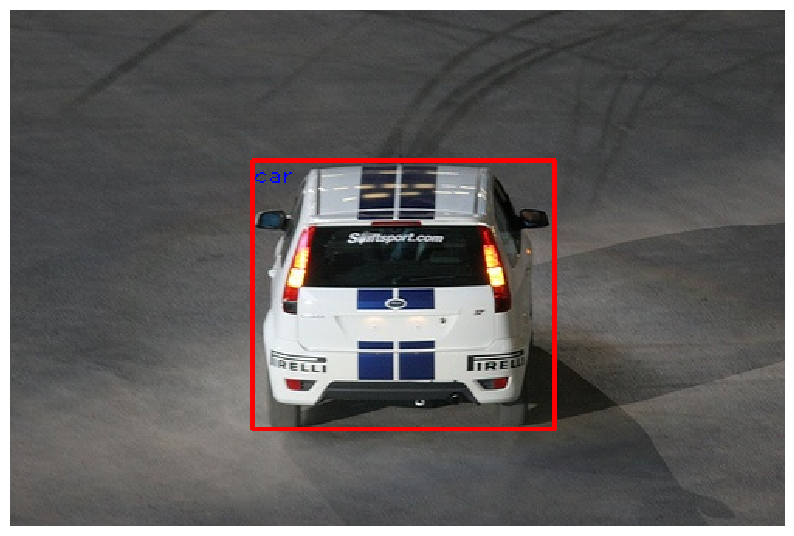

# Results and interpretation

## Submitted report

The [original report](../reports/lab_report.pdf) records the following results
for 50-epoch experiments:

| Original experiment label | mAP |
| --- | ---: |
| Regular YOLO loss, with positive sample filtering | 12.30% |
| Regular YOLO loss, without positive sample filtering | 11.33% |
| Focal loss, without positive sample filtering | 11.51% |

The report identifies objectness estimation and bounding-box localization as
major limitations: duplicate detections, background false positives, missed
objects, and boxes that do not align with the object extent. The small training
subset and 224 × 224 input resolution limit this teaching model's performance.

## Preserved notebook evidence

Notebook outputs were cleared for readable diffs and quick rendering on GitHub.
The complete per-class AP summaries were extracted before cleanup:

| Original saved output | mAP | Evidence |
| --- | ---: | --- |
| First detector notebook, final evaluation | 11.31% | [Saved AP summary](results/single_stage_detection.txt) |
| Answers notebook, summed cross entropy | 11.33% | [Saved AP summaries, original cell 88](results/loss_experiments.txt) |
| Answers notebook, first saved focal evaluation | 10.45% | [Saved AP summaries, original cell 92](results/loss_experiments.txt) |
| Answers notebook, repeated focal evaluation | 10.37% | [Saved AP summaries, original cell 93](results/loss_experiments.txt) |

These outputs came from the original files; they were not recomputed during
cleanup. The original first notebook's visible classification code uses per-image
focal loss with gamma 5 and alpha 0.25. The answers notebook starts with cross
entropy and later uses summed focal loss with gamma 3 and alpha 0.25.

The report and saved outputs do not establish one reproducible set of scores.
In particular, the report associates 10.37% with gamma 7, while the visible code
for the repeated saved evaluation uses the same trained model as the gamma 3
experiment. Execution history or earlier runs may explain the difference, but
the retained artifacts do not prove the cause.

## What “without filtering” means in this code

The original lab asks for classification without positive sample filtering.
However, `PredictionNetwork.forward` already extracts only positive-anchor class
logits before `ObjectClassification` receives them. The later loss functions sum
those supplied losses and divide by batch size, whereas the initial loss averages
within each image and then across images.

Consequently these implementations compare classification-loss reductions and
loss functions over positive anchors. They do not train classification on all
background anchors. Both the report's original labels and the code's actual
behavior are retained and described separately.

## Evaluation scope

- Training uses the first 2,500 images of VOC 2007 `train`; evaluation uses `val`.
- The saved evaluation calls use objectness threshold 0.8 and NMS threshold 0.3.
- NMS is class agnostic, following the lab implementation.
- The evaluator uses its default IoU threshold of 0.5 and its own AP integration;
  these results are not presented as an official VOC 2007 test-set benchmark.
- The helper export format does not distinguish VOC `difficult` objects.
- A local checkpoint is retained, but the artifacts do not establish which
  historical run produced it.

The optional evaluator now runs with `--no-animation --no-plot`, supported by
the [upstream command-line interface](https://github.com/Cartucho/mAP/blob/master/main.py).
This avoids the Matplotlib window-title failure present in the saved outputs.
Repository cleanup also fixes device selection, singleton inference, degenerate
IoU, and export handling; historical scores have not been revalidated after those
changes. Dependency ranges provide a usable environment rather than a lockfile
for the original runs. The evaluator clone is not pinned to a historical revision.

## Visual examples

Both images below were extracted from the original answers notebook. Red denotes
ground truth; green denotes predictions. The first illustrates a memorized
training example, and the second shows predictions from the broader training run.

| Small-subset overfit | Broader training run |
| --- | --- |
|  |  |
